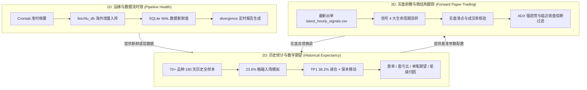

# Finalyst 量化系统 - 3D 策略有效性三维验证与 AI 持续迭代指南 (3dverify.md)

> [!NOTE]
> 本文档定义了 `divergence`（大级别 S/R 阻力支撑 + 小时级多指标背离 + 斐波那契微结构）量化策略在生产环境下的 **3D（三维）有效性验证体系**，并详细说明如何指挥 **Antigravity AI Agent** 进行全自动化日常巡检、归因诊断与闭环迭代优化。

---

## 1. 3D 验证体系总架构

量化策略的生命力不仅在于“代码能跑通”，更在于“具备统计正期望”并“经受住实盘行情的滑点与极端环境考验”。三维验证体系将验证划分为互为依托的三个层面：



---

## 2. 第一维 (1D)：运维与数据流准时性验证 (Pipeline Health)

确保定时调度按照中国期货交易小节准时唤醒，数据无丢失、无锁死、报告准时生成。

### 2.1 核心监测矩阵

| 监测项 | 达标标准 | 验证手段 | 异常应对 SOP |
| :--- | :--- | :--- | :--- |
| **Crontab 唤醒率** | 100% 按计划执行（每日 9 次） | `grep CRON /var/log/syslog` | 检查 cron 守护进程：`systemctl status cron` |
| **海外抓取时延** | 71 品种增量 $\le 60\text{s}$ | 查看 `logs/pipeline.log` 耗时 | 若超时，检查海外网络代理与 CDN 连通性 |
| **数据源新鲜度** | 最新 Bar 时间与停盘时间误差 $\le 2\text{m}$ | `python fetchfu_db/main.py --status` | 手动补录：`python fetchfu_db/main.py --incremental` |
| **数据库并发锁** | 零 Database Locked 异常 | SQLite WAL 模式监控 | 确认策略端严格以只读模式 (`?mode=ro`) 访问 |
| **报告生成时效** | 停盘后 2 分钟内更新 CSV | 检查 `latest_hourly_signals.csv` 时间戳 | 查看 `logs/pipeline.log` 尾部错误堆栈 |

### 2.2 1D 快捷自检命令集
```bash
# 1. 检查流水线最新执行日志
tail -n 30 /home/elvelyn/myapp/finalyst/logs/pipeline.log

# 2. 检查底层数据更新时间
/home/elvelyn/myapp/finalyst/.venv/bin/python /home/elvelyn/myapp/finalyst/fetchfu_db/main.py --status

# 3. 检查策略系统状态与最新报告
/home/elvelyn/myapp/finalyst/.venv/bin/python /home/elvelyn/myapp/finalyst/divergence/main.py --status
```

---

## 3. 第二维 (2D)：历史量化与数学期望检验 (Historical Backtesting)

利用系统内置的量化回测引擎 [src/evaluator.py](file:///home/elvelyn/myapp/finalyst/divergence/src/evaluator.py)，在 SQLite 历史 1H 数据上进行非未来函数的全样本回测，检验策略的统计显著性。

### 3.1 核心量化指标评估基准

| 评估指标 | 指标物理意义 | 健康基准线 | 优秀基准线 | 说明与风控要求 |
| :--- | :--- | :--- | :--- | :--- |
| **整体胜率 (Win Rate)** | 净盈利交易占比 ($PnL > 0$) | $\ge 45.0\%$ | $\ge 52.0\%$ | 顺大逆小微结构，保本机制保障胜率 |
| **TP1 (38.2%) 触达率** | 价格到达第 1 目标位的概率 | $\ge 40.0\%$ | $\ge 55.0\%$ | 验证 23.6% 突破后惯性动能是否充足 |
| **盈亏比 (Profit Factor)** | 总盈利金额 / 总亏损金额 | $\ge 1.80$ | $\ge 2.50$ | 策略核心优势：以小博大的非对称分布 |
| **单笔期望 (Expectancy)** | 单笔平均净收益 ($R/\text{笔}$) | $> +0.30 R$ | $> +0.80 R$ | $1.0R$ 即开仓时设定的固定亏损金额 |
| **最大回撤 (Drawdown)** | 累计净值曲线的最大回撤 | $\le 8.0 R$ | $\le 4.5 R$ | 连续亏损承受上限 |

### 3.2 共振星级分层归因 (Resonance Attribution)
回测系统自动按共振级别切分统计看板：
- **⭐ (L1) 仅 MACD 双背离**：高频测试信号。期望收益适中，受震荡行情洗盘影响较大。
- **⭐⭐ (L2) MACD + RSI 或 归一化均量背离**：动能衰竭明确，胜率与盈亏比显著提升。
- **⭐⭐⭐ (L3) MACD + RSI + OI 减仓共振**：内盘独有优势形态（主力减仓止损推高假新高），反转确定性最高。

### 3.3 2D 常用执行命令
```bash
cd /home/elvelyn/myapp/finalyst/divergence

# 快速抽检活跃主力品种（螺纹钢、沪铜、沪深300股指）
/home/elvelyn/myapp/finalyst/.venv/bin/python main.py --eval --symbols RB0,CU0,IF0

# 全库 70+ 品种 180 天大样本回测
/home/elvelyn/myapp/finalyst/.venv/bin/python main.py --eval --days 180

# 结果导出路径：divergence/reports/backtest_trades.csv
```

---

## 4. 第三维 (3D)：实盘前瞻信号跟踪与生命周期检验 (Forward Paper-Trading)

针对每小时新生成的 [latest_hourly_signals.csv](file:///home/elvelyn/myapp/finalyst/divergence/reports/latest_hourly_signals.csv)，在实盘中验证后续行情的执行状态。

### 4.1 信号 4 大生命周期流转图

```
                【发出 1H 背离预警】
                         │
                         ▼
             [监控 23.6% 触发价 Entry]
                         │
        ┌────────────────┴────────────────┐
 (超过 12 根 K 线未破)             (盘中或收盘触及 Entry)
        ▼                                 ▼
【EXPIRED: 信号自然失效】           【ACTIVE: 进场持仓】
                                          │
                         ┌────────────────┴────────────────┐
                         ▼                                 ▼
                  【击穿 SL 止损位】                【抵达 TP1 (38.2%)】
                  (净亏损 -1.0R，退出)              (平仓 60%，剩余 40% 移动止损至成本保本)
                                                                   │
                                                  ┌────────────────┴────────────────┐
                                                  ▼                                 ▼
                                           【跌破成本保本】                  【触达 TP2 (66.7%) / EMA20】
                                           (剩余 40% 原价退出，整体净赚 +0.6R) (全部获利了结，整单录得 +2.5R 以上)
```

### 4.2 3D 前瞻重点排查清单
1. **滑点与挂单撮合**：对比 `收盘确认触发价` 与 `盘中触价触发价`，在快行情下的成交滑点是否超过 2 个跳 (ticks)；
2. **熔断规则有效性**：当大单边趋势爆发时，检查 `1D_ADX > 35` 是否成功拦截了逆势做空信号；
3. **临近收盘风险标记**：在 14:45~15:00 或凌晨收市前发出的信号，是否被正确标记为 `True`，避免隔夜跳空风险。

---

## 5. 如何使用 Antigravity AI Agent 持续验证与迭代优化

您不需要亲自编写复杂脚本或手动计算指标。作为您的量化开发工程师，您可以直接向我下达自然语言指令，驱动我执行全流程的巡检、诊断与代码调优。

### 5.1 场景一：日常系统健康巡检与异常排查

> **用户可以这样对我说：**
> *“帮我巡检一下过去 24 小时 fetchfu_db 和 divergence 的运行日志，看看有没有数据断流、超时或没有准时出单的情况。”*

**AI Agent 执行动作**：
1. 读取 `/home/elvelyn/myapp/finalyst/logs/pipeline.log` 提取所有 WARNING/ERROR；
2. 运行 `fetchfu_db` 与 `divergence` 的 `--status` 检查数据新鲜度；
3. 检查是否有品种拉取超时或数据库锁定；
4. 汇总一份清晰的系统巡检报告，如发现海外网络波动则自动调整超时重试参数。

---

### 5.2 场景二：历史回测与共振层级敏感度分析

> **用户可以这样对我说：**
> *“请回测过去 180 天有色金属和黑色系的表现，对比 L1、L2、L3 信号的真实胜率与盈亏比，给出优化建议。”*

**AI Agent 执行动作**：
1. 调用 `divergence/main.py --eval --symbols CU0,AL0,ZN0,NI0,RB0,HC0,I0,J0 --days 180`；
2. 解析生成的 `reports/backtest_trades.csv`；
3. 评估各板块的盈亏比分布；
4. 若发现 L1 信号胜率低于 40%，主动建议并修改 `config/config.yaml`，提高触发门槛（例如将 RSI 超买超卖门槛从 65/35 调整为 70/30）。

---

### 5.3 场景三：亏损单归因诊断与策略逻辑改进

> **用户可以这样对我说：**
> *“我注意到今天早盘 SC0（原油）的空头信号在入场后被迅速拉爆止损了，帮我调出当时的 K 线和指标，分析失败原因并优化过滤规则。”*

**AI Agent 执行动作**：
1. 查询 SQLite 中 `SC0` 在信号发生时及后续数小时的 1H K 线；
2. 检查当时的日线 ADX、大级别 S/R 热区位置与板块协同指数；
3. 诊断是属于“假背离突破”、“单边逼空强动能”还是“ATR 止损间距过窄”；
4. 如果是强动能导致，在 [src/filters.py](file:///home/elvelyn/myapp/finalyst/divergence/src/filters.py) 中引入“EMA20 斜率熔断”或“多头成交量倍量熔断”，并运行单元测试验证。

---

### 5.4 场景四：合约参数维护与新品种上线

> **用户可以这样对我说：**
> *“交易所最近调整了螺纹钢和原油的手续费与跳动规则，并且新增了碳酸锂连续（LC0），帮我更新配置并验证。”*

**AI Agent 执行动作**：
1. 检查并更新 [divergence/config/instrument_config.json](file:///home/elvelyn/myapp/finalyst/divergence/config/instrument_config.json) 中的合约乘数、最小变动价位与板块归属；
2. 运行 `pytest divergence/tests/` 确保所有风控换算单元测试通过；
3. 单独对新合约运行 `--hourly --symbols LC0` 验证数据完整性与信号计算。

---

### 5.5 推荐搭配使用的 Slash Commands

| 命令 | 推荐使用场景 | 使用示例 |
| :--- | :--- | :--- |
| **`/boost`** | **深度归因与量化模型升级**<br>当需要重构核心算法（如波峰波谷识别、自适应 ATR 聚类）或进行深层次数学推导时使用。 | *“/boost 请分析当前 ATR-ZigZag 算法在震荡市频繁出现伪拐点的问题，设计自适应波动率聚类算法进行升级。”* |
| **`/goal`** | **长时间无人值守的全网格参数优化**<br>针对 70+ 品种遍历几十种参数组合（网格搜索最佳 ATR 乘数、止损步长等）。 | *“/goal 对过去 1 年数据运行网格参数寻优，寻找黑色系和能化板块各自夏普比率最高的最优止损倍数组合，并输出调优报告。”* |
| **`/plan`** | **大型功能扩展开发前的方案对齐**<br>例如接入实盘 CTP 接口或搭建 Feishu/微信告警通道之前。 | *“/plan 我们准备为 divergence 增加企业微信群机器人实时推送功能，请给出分步架构设计。”* |
| **`/learn`** | **固化策略调试与交易习惯**<br>在纠正或设定了特定实盘交易偏好后，让 Agent 永久记住该规则。 | *“/learn 记住：对于股指期货（IF0, IC0, IM0），由于波动极大，单笔建议手数计算时必须将风险权重额外降低 50%。”* |

---

## 6. 3D 验证循环操作核对表 (Cheatsheet)

- [ ] **每日开盘前 (08:45 / 20:45)**：查看 `latest_hourly_signals.csv`，核对当日重点关注候选池与关键 S/R 热区；
- [ ] **盘中小节后 (10:16 / 11:31 / 14:31 / 22:01 / 23:01 / 00:01 / 02:35)**：检查是否有新增 L2/L3 信号，核实 23.6% 触发价；
- [ ] **每日收盘后 (15:30)**：
  - 检查全天数据同步状态（1D 验证）；
  - 对当日触发订单进行盈亏复盘并核算 $R$ 倍数（3D 验证）；
- [ ] **每周周末**：
  - 指示 Agent 运行 180 天全量历史回测：`python main.py --eval --days 180`（2D 验证）；
  - 审阅胜率与盈亏比漂移情况，必要时调整参数基准。
